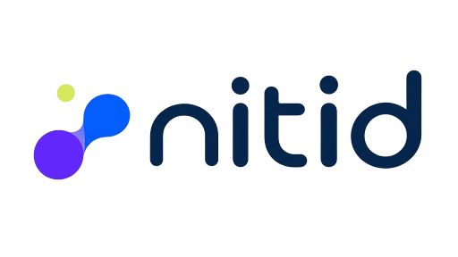

# Brand

This page is the source of truth for nitid's visual identity: the name, the
logo, the colours, the typography, and the sources of the images used in the
documentation. It exists so the README and the documentation site stay in step
instead of drifting apart.

## Name

**nitid**, from Latin *nitidus*: clear, transparent, precise. Always lowercase
in prose and in the wordmark, including at the start of a sentence. `NITID` in
capitals refers only to the Python class.

## Logo

| Asset | Use |
|-------|-----|
| [`assets/brand/nitid-logo-on-light.png`](assets/brand/nitid-logo-on-light.png) | Full logo on light backgrounds — navy wordmark |
| [`assets/brand/nitid-logo-on-dark.png`](assets/brand/nitid-logo-on-dark.png) | Full logo on dark backgrounds — light wordmark |
| [`assets/brand/nitid-mark.svg`](assets/brand/nitid-mark.svg) | The mark alone: favicons, avatars, and anywhere too small for the wordmark |
| [`assets/brand/nitid-background.png`](assets/brand/nitid-background.png) | Abstract background for hero areas |

The mark is three nodes — lime, blue, violet — joined into a detection graph.
Keep clear space around the logo of at least the diameter of the lime dot, do
not recolour the nodes, and do not set the navy wordmark on a dark background:
use the light variant instead.

## Demo images

| Asset | Source |
|-------|--------|
| [`assets/demo/source/ski.jpg`](assets/demo/source/ski.jpg) | AI-generated image (Google Gemini); no photographic source or third-party rights |
| [`assets/demo/detect-ski.jpg`](assets/demo/detect-ski.jpg) | `source/ski.jpg` with `nitid predict model=model1m task=detect source=docs/assets/demo/source/ski.jpg conf=0.5 save=true` |
| [`assets/demo/source/watchmaker.jpg`](assets/demo/source/watchmaker.jpg) | AI-generated image (Google Gemini); no photographic source or third-party rights |
| [`assets/demo/segment-watchmaker.jpg`](assets/demo/segment-watchmaker.jpg) | `source/watchmaker.jpg` with `nitid predict model=model1l task=segment source=docs/assets/demo/source/watchmaker.jpg conf=0.3 save=true` |
| [`assets/demo/street.jpg`](assets/demo/street.jpg) | Frame at 00:38 of [DiagonalCrosswalkYongeDundas.webm](https://commons.wikimedia.org/wiki/File:DiagonalCrosswalkYongeDundas.webm) by Raysonho (Wikimedia Commons, CC0). Left: `task="detect"`; right: `task="segment"`, both `model1s`, `conf=0.5` |
| [`assets/demo/track.gif`](assets/demo/track.gif) | 00:33–00:38 of the same CC0 video. `model1s` detection with `track()` (ByteTrack), `vid_stride=2`, 600 px wide at 8 fps |

Every image the documentation shows must have a recorded source here, and its
licence must allow redistribution. Unannotated originals live in
`assets/demo/source/`; the rendered results sit next to them in `assets/demo/`.

## Colour

The dark palette is the product palette: it is what nitid looks like on the
website and in the documentation.

| Role | Hex |
|------|-----|
| Background | `#060b1a` |
| Surface | `#0d1530` |
| Surface, sunken | `#080e21` |
| Text | `#e8ecf7` |
| Text, muted | `#b9c4dd` |
| Text, dimmed | `#8794b8` |
| Text, faint | `#6b7ba3` |
| Border | `#ccd5e8` at low alpha |
| Link | `#7fb0ff` |
| Accent (lime) | `#cfe85b` |
| Primary action (blue) | `#1266f2`, hover `#0b52cc` |
| Violet | `#7c22f0`, hover `#6a17d6`, light `#a78bfa` |

The logo carries its own fixed values, which are deliberately more saturated
than the interface palette: navy `#05254b`, violet `#6227fb`, blue `#045efd`,
lime `#cfe85b`.

## Typography

| Role | Family | Weight |
|------|--------|--------|
| Headings | Archivo | 800 |
| Body | Inter | 400 / 500 |
| Code | JetBrains Mono | 400 |

Each has a system fallback stack, so nothing breaks when the webfonts are
unavailable.

